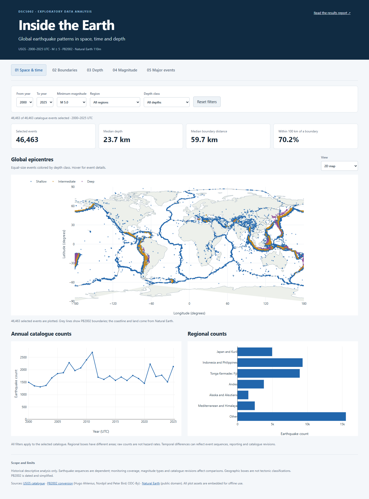

# Inside the Earth

## 最新五列海报与扩充实验（2026-11-10）

- [可搜索 A0 学术海报 PDF](deliverables/DSC5002_Academic_Poster.pdf)
- [海报展示讲稿 PDF](deliverables/DSC5002_Presentation_Script.pdf)
- [在线海报与全部结果](https://victoriasu551.github.io/DSC5002-Earthquake-Explorer/)
- [2.0 / 3.0 整合说明与完整复现顺序](docs/EXPERIMENT_EXTENSION.md)
- [组员成果评审、修改清单与复现方法](docs/TEAM_REVIEW.md)
- [整合后的公开结果](docs/final_results/RESULTS.md)

本地从 `START_HERE.html` 开始；整合仪表盘是 `outputs/final/dashboard.html`。
Member 3 的剖面、Member 4 的震级分析及 RQ5 动画已合入源码。
Member 2 的统计改用统一的 46,463 条地震记录；46,523 条中的 60 条非地震
事件不得混入。原稿已校验并保存在 `local_sources/team_submissions`，`others` 已移除。
最新海报为 **A0 横版、五列、8 张表格、9 组证据图**；按内容实测高度连续排版，压缩段落与图表间的大块留白；加入震级门槛空间敏感性与固定半径下的时间窗比较；完整报告保留全部 14 组研究图。
新增等面积/纬度控制空间参照、地区关联热图、事件数与相对能量对比、累计时间曲线。
100 km 内地震占比 70.15%，等面积参照 9.42%，纬度控制 10.50%。7.45 倍是描述性
占比比值，不是风险倍数。海报以静态图直接呈现结果，不加非必要动画链接。
旧海报已覆盖，交付入口只链接最新版；下面保留基础流水线及可比性补充的方法说明。

**DSC5002 Exploratory Data Analysis and Visualization — earthquake project baseline.**

A reproducible Python implementation of the supplied project proposal, covering all five research questions with real USGS observations, spherical PB2002 boundary distances, twelve figures, a standalone interactive dashboard and an English results report. Team assignments are intentionally omitted.

## 年度与地区扩展分析 2026年11月3日

新增 **9 张研究图、14 个公开汇总表/JSON、可比性报告和离线交互比较工具**。已按年份、地区和 M≥5/5.5/6/7 分层比较，检查震级类型构成、误差字段缺失、深度取值集中现象、记录状态、来源网络、等长时段和大型事件窗口敏感性。

- [中文结果摘要与全部新增图](docs/temporal_regional_v2/RESULTS.md)
- [完整 HTML 报告](docs/temporal_regional_v2/report.html)（克隆仓库后可直接用浏览器打开）
- [离线交互比较工具](docs/temporal_regional_v2/dashboard.html)（包含全部资源，不需要 Python 或网络）
- [可复现方法与验证说明](docs/TEMPORAL_ANALYSIS.md)

后十三年（2013–2025）相对前十三年（2000–2012）的时间暴露调整记录率为 **M≥5 −6.63%、M≥6 −15.42%**。M≥5 全期 Sen 斜率却为正，说明窗口和门槛的选择影响描述。震级类型与质量字段报告口径也发生明显变化；这些结果不能直接解释为真实地震活动或灾害风险的变化。

```powershell
python run_pipeline.py                  # 新克隆首次建立基础数据；已有已验证数据时无需重跑
python run_temporal_analysis.py         # 只读校验基础快照，单独生成新版结果
python verify_temporal_analysis.py
python -m pytest -q
```

本轮本地结果在 `outputs/temporal_regional_v2_20261103`，公开汇总结果在 `docs/temporal_regional_v2`。基础数据和原有 30 个交付文件均保持原哈希。`--publish` 可将重新生成的汇总结果复制到公开文档目录；它不会执行 Git 推送。

## 快速使用

本地成品已生成，可以直接双击打开：

- `outputs/final/dashboard.html`：整合后的离线交互面板，包含地区深度剖面、3D 震源视图和事件探索工具。
- `outputs/final/report.html`：当前英文结果报告，包含 14 组图及方法与解释边界。
- `data/processed/earthquakes.csv`：清洗及派生变量后的完整分析数据。
- `outputs/final/tables/`：当前统计表、Spearman 相关系数和敏感性分析。

所有文件均位于 `5002final`。公开仓库包含代码、测试、文档、来源清单，以及本轮用户要求同步的汇总图表、报告和交互页；完整事件级数据、旧版生成目录和输入 Word 计划保存在本地。克隆仓库后运行下列命令即可重新生成基础版本。

```powershell
python -m venv .venv
.\.venv\Scripts\python.exe -m pip install -r requirements.txt
.\.venv\Scripts\python.exe run_pipeline.py
.\.venv\Scripts\python.exe verify_results.py
.\.venv\Scripts\python.exe -m pytest -q
Start-Process .\outputs\dashboard.html
```

Python **3.11 or 3.12** is required; the local baseline was checked with Python 3.12.3. No API key is required. The first run needs internet access to USGS and raw.githubusercontent.com. Subsequent runs can use the verified cache:

```powershell
python run_pipeline.py --offline
```

`--offline` makes no HTTP requests. Source downloads and the expensive distance calculation are reused only when their stored SHA256 hashes and relevant configuration/code bindings match. Browser use requires a modern browser with WebGL for the 3D views; the 2D views and report work without those views.

## Research scope

| Question | Implemented baseline |
| --- | --- |
| RQ1 Where and when? | Annual counts, regional count heatmap, global point map and rotatable globe |
| RQ2 Near plate boundaries? | Exact spherical nearest-segment distances, histogram and regional ECDFs |
| RQ3 Regional depth? | Depth classes, histograms, boxplots, longitude–depth projections and 3D hypocentres |
| RQ4 Magnitude and frequency? | 0.1-magnitude histogram, exact cumulative counts and descriptive correlations |
| RQ5 Major events? | Sumatra Andaman 2004, Maule 2010 and Tohoku 2011; fixed local maps and timelines |

The observation window is **[2000-01-01, 2026-01-01) UTC**, preferred magnitude **M ≥ 5**, event type **earthquake**. A saved count query and 26 annual CSV downloads reconcile to **46,463** unique events in this snapshot. Cleaning retains all of them. Downloads can change when USGS revises its catalogue; the saved manifest defines this local snapshot.

Selected baseline results are reported in [docs/BASELINE_RESULTS.md](docs/BASELINE_RESULTS.md). They describe the downloaded catalogue, not hazard forecasts or causal effects.



## Data and methods

- [USGS Earthquake Catalog](https://earthquake.usgs.gov/fdsnws/event/1/) provides preferred event IDs, UTC time, latitude, longitude, depth, magnitude, magnitude type, place and review status. Annual requests avoid the 20,000-event response limit. The pipeline deduplicates IDs and applies the half-open study interval locally.
- [PB2002 GeoJSON conversion](https://github.com/fraxen/tectonicplates) provides 241 mapped boundary features. Every consecutive pair of vertices defines a minor great-circle arc. The distance algorithm tests on-arc perpendicular projections and endpoints on a sphere of radius 6371.0088 km. This is spherical geodesy, not an ellipsoidal estimate or a measure of geological uncertainty.
- [Natural Earth 110m](https://www.naturalearthdata.com/downloads/110m-physical-vectors/) supplies coastlines and land polygons, including the globe's land mask. Both geography repositories are pinned to commits in [data/sources.lock.json](data/sources.lock.json).

Regions are priority-ordered geographic boxes in `config.json`, with a catch-all **Other** category. Date-line crossing boxes are supported. Raw regional counts are not normalized by area. Depth classes are shallow **<70 km**, intermediate **70–<300 km**, and deep **≥300 km**. Missing depths remain in the cleaned dataset and are omitted only from analyses that require depth; negative recorded depths are retained and flagged.

Case anchors are the maximum-magnitude observations on the three predefined dates. Case samples use spherical epicentral distance ≤500 km and equal 30-day windows **[−30,0)** and **[0,30)** relative to the anchor's exact timestamp, excluding the anchor ID. Their dedicated dashboard tab uses the full M≥5 catalogue; it hides the global filters and explicitly states this independent scope.

Sensitivity tables vary regional boxes by ±2°, depth cutoffs and the case windows/radii. Spearman coefficients are descriptive and repeated by region and two equal 13-year periods. No independent-observation p-values, fitted predictive models or causal claims are reported. Globe, relationship and 3D hypocentre displays cap plotted points at 8,000 and disclose sampling; statistical summaries use every eligible event. Static figures use all available rows.

## Layout

```text
config.json                     Study window, geographic boxes and case definitions
run_pipeline.py                 Download → clean → distances → tables → figures → HTML
verify_results.py               Independent source/count/case/spatial/artifact checks
earthquake_explorer/             Acquisition, geometry, analysis and rendering modules
web/                            Embedded dashboard HTML/CSS/JavaScript source
tests/                          Small synthetic regression cases; no network required
scripts/                        Download-only, preparation-only and optional browser QA
data/sources.lock.json           Versioned URLs, access timestamps and source hashes
data/raw/                       Local verified raw CSV and geography files (Git-ignored)
data/processed/                  Local analysis dataset, audit and processing seal (ignored)
outputs/                        Local report, dashboard, figures, tables and QA receipts
local_sources/                   Local copy of the input DOCX (Git-ignored)
docs/                           Methods, limitations, baseline snapshot and preview
```

## Validation

```powershell
python -m pytest -q
python verify_results.py
```

`verify_results.py` rechecks source hashes, independently reconciles annual/depth/magnitude/case counts and validates 256 sampled distances against an independent PB2002 spherical-node oracle with ≤1 km node spacing. A node distance must upper-bound the arc distance by no more than 0.501 km; this numerical bound does not quantify map or geological uncertainty. It also verifies all generated artifact hashes.

Optional browser QA checks filters, the empty-result state, the globe, date-line sections, 3D hypocentres, exact case counts, mobile layout, report images and absence of HTTP requests. Install Playwright plus Chromium separately if desired, then run `node scripts/browser_smoke.cjs`. `PLAYWRIGHT_BROWSER_CHANNEL=msedge` allows an installed Edge browser. The project itself has no Node runtime requirement. The browser fixture intentionally checks the delivered 46,463-event baseline and must be updated if the observation scope or catalogue snapshot changes.

GitHub Actions runs the network-free regression suite on Python 3.11 and 3.12. CI does not pretend to validate a new USGS snapshot without downloading and checking it.

## Limits and remaining work

An M5 threshold does not prove uniform completeness. The catalogue mixes magnitude types, includes dependent event sequences and can be revised. PB2002 is simplified and dated. Regional boxes differ in size and composition. Cross-sections project all latitudes in a broad box and exaggerate vertical scale. The local 3D coordinate approximation is for display only. Results apply to recorded events in the selected window.

This baseline does not implement magnitude homogenization, completeness estimation, declustering, narrow trench-normal sections, formal hypothesis testing, causal identification, hazard prediction, a presentation deck or team allocation. The optional animation is deferred because static timelines already show the selected sequences.

Code is MIT-licensed; data and bundled runtime assets keep their own terms. See [THIRD_PARTY.md](THIRD_PARTY.md), [docs/DATA_DICTIONARY.md](docs/DATA_DICTIONARY.md) and [docs/REPRODUCIBILITY.md](docs/REPRODUCIBILITY.md).
