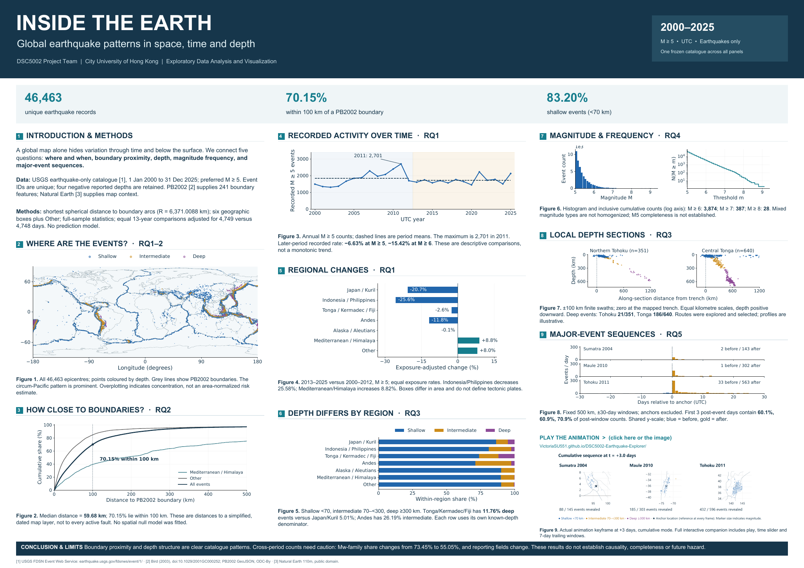

# 最终整合结果

- [学术海报 PDF](../../deliverables/DSC5002_Academic_Poster.pdf)
- [完整整合报告](report.html)（下载后可离线打开，或使用 GitHub Pages 同路径）
- [在线动画](https://VictoriaSU551.github.io/DSC5002-Earthquake-Explorer/)
- [组员成果评审](../TEAM_REVIEW.md)
- [讲稿 PDF](../../deliverables/DSC5002_Presentation_Script.pdf)

统一冻结目录：46,463 条 M≥5 地震，2000–2025 UTC。主要结论：70.15% 在
PB2002 边界 100 km 内；83.20% 为浅源；后十三年 M5 记录率低 6.63%；
Tonga/Kermadec/Fiji 深源占比 11.76%；M≥7 有 387 条，M≥8 有 28 条。
所有解释均为描述性，非预测或因果结论。

本目录只发布图、汇总表和验证结果。原始投稿和完整原始目录留在本地。
