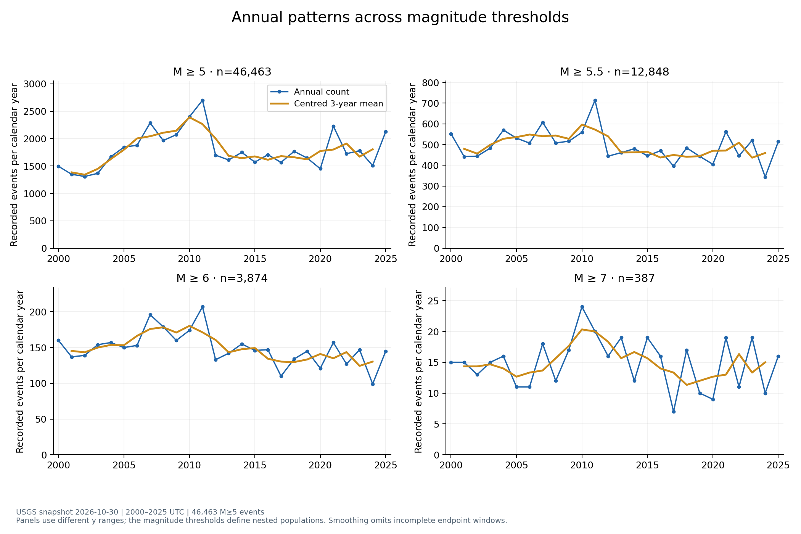
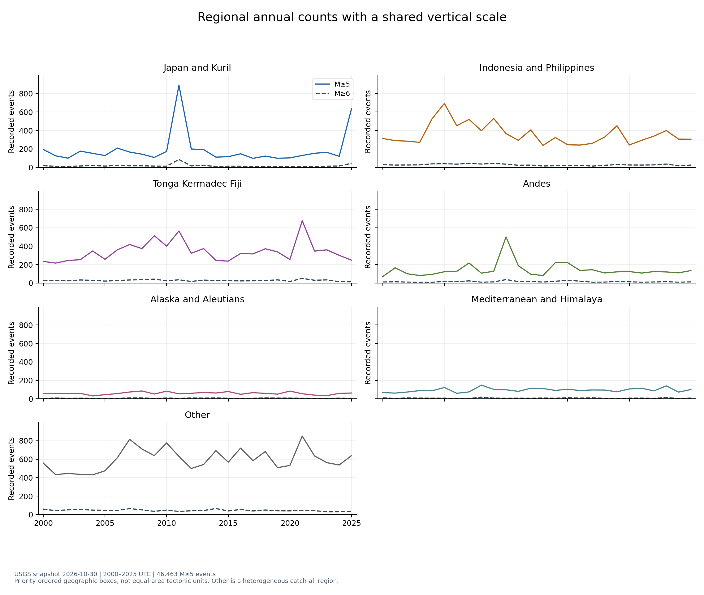
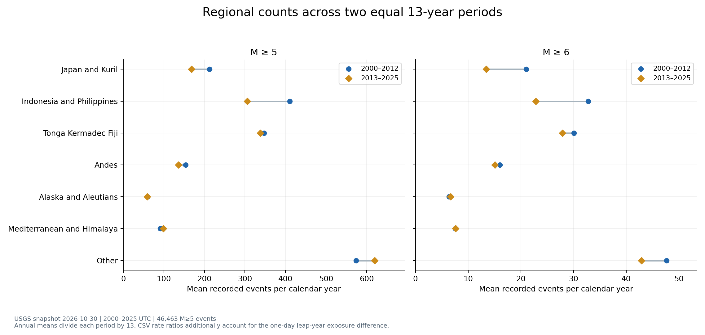
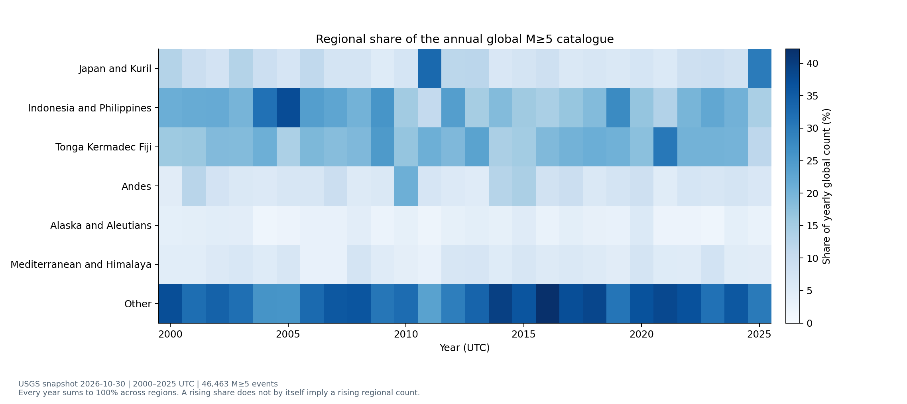
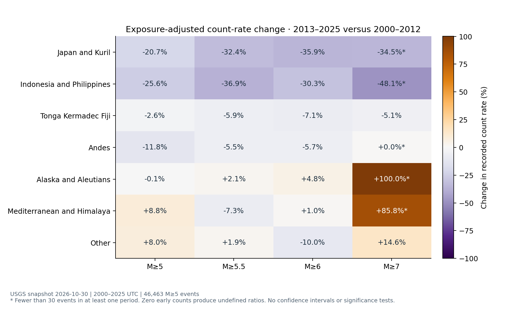
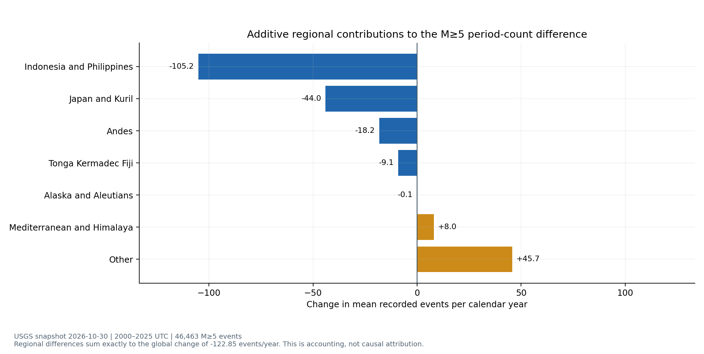
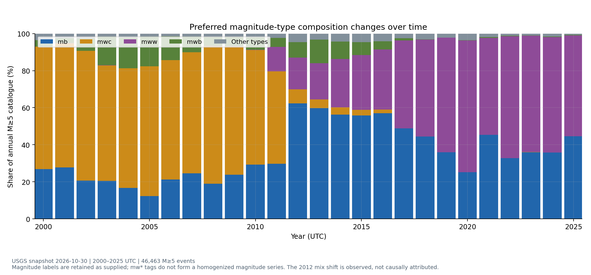
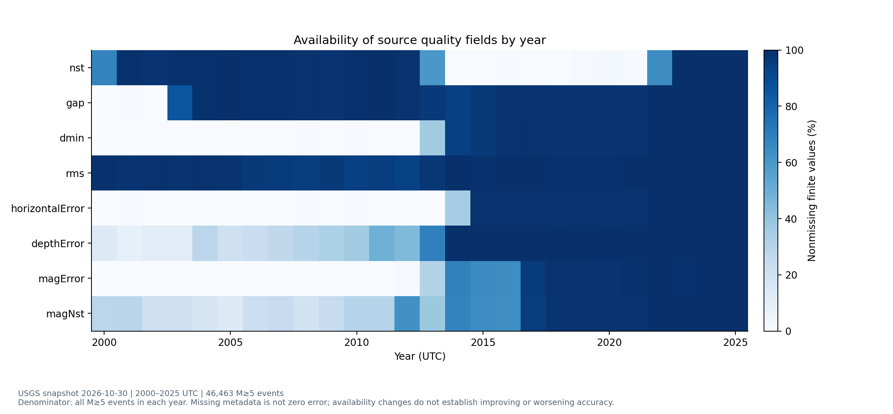
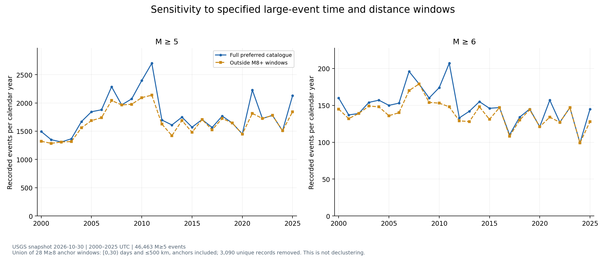

# 年度与地区变化及时间可比性

分析日期：2026-11-03。数据快照：2026-10-30，USGS 2000–2025 年 M≥5 地震，共 **46,463 条**。本轮未重新下载目录，基础数据与原有 30 个交付文件的哈希保持一致。

## 核心结果

| 门槛 | 2000–2012 数量 | 2013–2025 数量 | 后期相对前期的记录率变化 |
| --- | ---: | ---: | ---: |
| M≥5 | 24,030 | 22,433 | −6.63% |
| M≥5.5 | 6,877 | 5,971 | −13.16% |
| M≥6 | 2,099 | 1,775 | −15.42% |
| M≥7 | 203 | 184 | −9.34% |

两个时段均为 13 个完整日历年；变化率已校正 4,749 与 4,748 天的暴露差异。以上是固定目录中的记录率，不能直接解释为真实地震发生率或灾害风险。

M≥5 的年度峰值为 2011 年 2,701 条，低值为 2002 年 1,309 条。全期 Sen 斜率为每推移一年、年度数量增加约 7.83 条，但后十三年的均值低于前十三年；不同摘要方向不一致，反映波动和窗口依赖，不能概括为单调增长。M≥5.5 与 M≥6 的全期描述性斜率为负，M≥7 的中位数斜率为零；这里不把零斜率解释为“证明没有变化”。

## 地区差异

| 地区 | 前期年均数量 | 后期年均数量 | 暴露调整记录率变化 | 全球份额变化 |
| --- | ---: | ---: | ---: | ---: |
| Japan and Kuril | 212.54 | 168.54 | −20.69% | −1.73 个百分点 |
| Indonesia and Philippines | 410.77 | 305.62 | −25.58% | −4.51 个百分点 |
| Tonga Kermadec Fiji | 347.00 | 337.92 | −2.60% | +0.81 个百分点 |
| Andes | 154.08 | 135.85 | −11.81% | −0.46 个百分点 |
| Alaska and Aleutians | 59.54 | 59.46 | −0.11% | +0.22 个百分点 |
| Mediterranean and Himalaya | 90.92 | 98.92 | +8.82% | +0.81 个百分点 |
| Other | 573.62 | 619.31 | +7.99% | +4.86 个百分点 |

各地区使用同一套优先顺序和边界定义。地区面积不同，数量不能当作等面积风险比较；Other 是其余地区的集合。份额上升也不意味着数量一定上升，例如 Tonga Kermadec Fiji 的数量略降、全球份额却升。

## 时间可比性

- **时间与提取口径可以对齐**：26 个年度分批文件及 312 个日历月已检查，没有零记录月份；这只能说明请求时间分区完整，不能证明探测完整性。
- **震级类型构成不同**：`mw*` 标签占比从前期 73.45% 降至后期 55.05%；2011 年为 69.94%，2012 年为 37.34%。这不是经过重新估计的同质 Mw 目录，也没有证据把该断点归因于某一具体政策。
- **误差字段的报告口径不同**：水平误差字段可用率约从 0.28% 升至 86.80%，深度误差字段从 28.01% 升至 97.76%；缺失不能当作零误差，可用率上升也不能单独证明精度改善。台站数 `nst` 的字段可用率反而下降，说明字段报告变化并非单一方向。
- **深度取值集中现象不同**：恰好 10 公里的记录占比从 27.94% 升至 41.01%，恰好 33 公里从 9.22% 降至 0.11%。USGS 说明部分深度可能被固定，但仅凭相等值无法识别哪些个体记录被固定，本轮没有删除这些记录。
- **序列相关仍存在**：不能把所有记录当作相互独立事件并套用简单 Poisson 误差。也不能从只有 M≥5 的截断样本推断所有时期都达到统一的完整性门槛。

## 敏感性与结论边界

对所有 28 个目录 M≥8 事件，剔除其后 30 天内、500 公里范围内窗口的并集（包括锚点、重叠只算一次）后，移除 3,090 条，保留 43,373 条。M≥5 两段记录率变化由 −6.63% 变为 −3.37%。这是指定窗口敏感性，不是完整余震识别或去丛集，也不是因果分解。

另提供 ±2° 地区边界、已审核记录、`mw*` 子样本、多年分块和不同门槛的汇总比较。所有结果均保留，不按变化方向挑选结果。

[完整报告](report.html) · [离线交互工具](dashboard.html) · [汇总表](tables) · [验证摘要](validation.json) · [方法与复现说明](../TEMPORAL_ANALYSIS.md)

官方解释参考：[USGS 目录波动与探测](https://www.usgs.gov/faqs/why-are-we-having-so-many-or-so-few-earthquakes-has-naturally-occurring-earthquake-activity)、[震级类型](https://www.usgs.gov/programs/earthquake-hazards/magnitude-types)、[深度固定值](https://www.usgs.gov/faqs/why-do-so-many-earthquakes-occur-a-depth-10km)。这些来源支持解释边界，本文数值来自已保存的项目数据。
